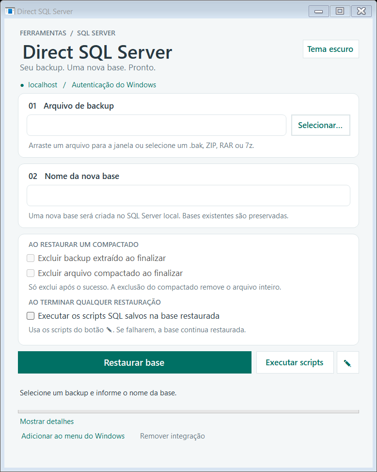

# Direct SQL Server

Aplicativo para **Windows** que restaura um backup do SQL Server em uma **base nova** no seu computador, em poucos cliques. Você escolhe o `.bak` (ou um ZIP, RAR ou 7z que contenha o `.bak`), digita o nome da base e clica em **Restaurar base**. Sem abrir o SSMS, sem escrever `RESTORE DATABASE`, sem descompactar nada à mão.

  

> **Versão atual: 1.6.0.** Veja o que mudou nas [notas de versão](CHANGELOG.md).

## Sumário

- [Destaques](#destaques)
- [Como funciona](#como-funciona)
- [Requisitos](#requisitos)
- [Instalação passo a passo](#instalação-passo-a-passo)
- [Restaurar um backup passo a passo](#restaurar-um-backup-passo-a-passo)
- [Backup dentro de um compactado](#backup-dentro-de-um-compactado)
- [Executar scripts SQL na base restaurada](#executar-scripts-sql-na-base-restaurada)
- [Menu do botão direito no Explorer](#menu-do-botão-direito-no-explorer)
- [Tema claro e escuro](#tema-claro-e-escuro)
- [Atualizações automáticas](#atualizações-automáticas)
- [Segurança e o que o app nunca faz](#segurança-e-o-que-o-app-nunca-faz)
- [Onde ficam seus dados](#onde-ficam-seus-dados)
- [Solução de problemas](#solução-de-problemas)
- [Desinstalar](#desinstalar)
- [Limitações conhecidas](#limitações-conhecidas)

---

## Destaques

- **Um fluxo só:** arquivo, nome da base, **Restaurar base**. A conclusão aparece na própria janela.
- **Aceita compactados:** ZIP, RAR, 7z, TAR, GZ, BZ2 e XZ. O motor 7-Zip já vem junto; você não precisa instalar 7-Zip nem WinRAR.
- **Arrastar e soltar** um arquivo para a janela.
- **Nunca substitui nada:** se já existir uma base com o nome escolhido, a restauração é recusada e nada é alterado.
- **Seguro por padrão:** conecta só no SQL Server **do próprio computador**, com a **autenticação do Windows**. Não pede nem guarda senha.
- **Scripts pós-restauração:** botão para rodar, e editar, comandos SQL na base restaurada.
- **Menu do Explorer:** botão direito no arquivo → *Restaurar no SQL Server…* (opcional).
- **Tema claro e escuro.**
- **Atualização automática** com um clique.

## Como funciona

1. Você escolhe um arquivo. Se for um compactado, o app procura os `.bak` dentro dele (inclusive em subpastas); se houver vários, você escolhe qual restaurar.
2. Você informa o nome da **nova** base. O app sugere um nome a partir do arquivo.
3. Ao clicar em **Restaurar base**, o app extrai o `.bak` (se vier de um compactado), lê o conteúdo do backup e restaura todos os arquivos de dados e de log **com nomes novos e exclusivos** nas pastas padrão da instância. Ele **não** usa os caminhos do servidor de origem.
4. A restauração acontece primeiro com um nome interno (`DirectSqlRestore_<código>`). Só no final uma renomeação atômica publica a base com o nome que você escolheu.
5. Terminou: atualize a lista **Bancos de Dados** no SSMS com **F5**.

Se o arquivo `.bak` contiver vários backups completos da mesma base, o app usa o **mais recente**. Os detalhes (nome original, data e conjunto) aparecem em **Mostrar detalhes**.

## Requisitos

| Item | Requisito |
|---|---|
| Sistema | Windows 10 ou 11, 64 bits |
| .NET | **.NET 9 Desktop Runtime**. O instalador baixa e instala sozinho se você não tiver. |
| SQL Server | Instância **padrão local** (`MSSQLSERVER`), acessível como `localhost` |
| Permissões | Seu usuário do Windows precisa poder **restaurar bancos** e **listar os bancos existentes** |
| Espaço em disco | O tamanho do backup extraído (se vier de um compactado) mais o espaço da nova base |

> O backup precisa ser de uma versão do SQL Server **igual ou mais antiga** que a instalada no seu computador.

## Instalação passo a passo

1. Abra a página de [**Releases**](../../releases/latest) deste repositório.
2. Em **Assets**, baixe **`DirectSqlServer-win-Setup.exe`**.
3. Dê um duplo clique no arquivo. A instalação é **por usuário**: não pede senha de administrador e leva poucos segundos. Se faltar o .NET 9 Desktop Runtime, o instalador o instala junto.
4. Ao terminar, o app abre sozinho. Ele também cria atalhos na **área de trabalho** e no **menu Iniciar** com o nome **Direct SQL Server**.

### Aviso "O Windows protegeu o computador"

O instalador não tem assinatura digital paga, então o Windows SmartScreen pode mostrar essa tela na primeira execução. Clique em **Mais informações** e depois em **Executar assim mesmo**. Isso acontece só na instalação.

## Restaurar um backup passo a passo

### 1. Abra o app

Abra **Direct SQL Server** pelo atalho. A janela abre vazia, pronta para receber o arquivo.

  

A faixa verde **localhost / Autenticação do Windows** lembra onde o app vai restaurar: o SQL Server deste computador, com o seu usuário do Windows.

### 2. Escolha o arquivo de backup

Faça **um** destes:

- clique em **Selecionar…** e escolha o arquivo; ou
- **arraste** o arquivo do Explorer para dentro da janela; ou
- use o [menu do botão direito](#menu-do-botão-direito-no-explorer), que já abre o app com o arquivo selecionado.

Aceita `.bak`, `.zip`, `.rar`, `.7z` e outros formatos de compactado. Selecione **um arquivo por vez**.

### 3. Confira o nome da nova base

O campo **02 Nome da nova base** é preenchido com o nome do arquivo. Altere se quiser. O nome pode ter acentos e espaços; só não pode ser vazio, ter caracteres de controle, ter mais de 128 caracteres nem ser o nome de uma base do sistema (`master`, `model`, `msdb`, `tempdb`).

Quando o arquivo é um `.bak`, a janela mostra **"Pronto para restaurar em uma nova base."**

  

### 4. Clique em Restaurar base

O botão muda para **Restaurando…**, a barra de progresso avança e a janela **não fecha pelo X** até terminar, para não interromper a operação no meio.

  

### 5. Veja o resultado

Se deu certo, aparece em verde **"Base “Vendas” restaurada com sucesso. Atualize a lista no SSMS (F5)."**

  

Se algo falhar, a mensagem aparece em vermelho e a seção de **detalhes** abre sozinha com o que aconteceu. Um registro completo é salvo em `%LOCALAPPDATA%\DirectSqlServer\Logs`.

  

Use **Mostrar detalhes** / **Ocultar detalhes** quando quiser ver o passo a passo da restauração, mesmo sem erro.

## Backup dentro de um compactado

Selecione o ZIP, RAR ou 7z normalmente. O app procura o `.bak` lá dentro; **você não precisa extrair nada**.

- **Um `.bak` no compactado:** ele é usado direto, e o nome da base sugerida vem do nome do `.bak`.
- **Vários `.bak`:** abre uma janela para você escolher qual restaurar.

  

### Onde o backup é extraído

Só o `.bak` escolhido é gravado, como `<NomeDaBase>.bak`, numa **nova pasta `<NomeDaBase>` ao lado do arquivo compactado**. Se já existir uma pasta com esse nome, a nova pasta recebe um sufixo, como ` (2)`. Caminhos de dentro do compactado nunca são usados como destino.

Reserve espaço livre equivalente ao tamanho do `.bak`.

### Opções de exclusão

Com um compactado selecionado, a caixa **AO RESTAURAR UM COMPACTADO** fica ativa:

| Opção | O que faz |
|---|---|
| **Excluir backup extraído ao finalizar** | Apaga o `.bak` extraído e a pasta criada, **depois** de restaurar com sucesso. |
| **Excluir arquivo compactado ao finalizar** | Apaga o compactado **inteiro** depois de restaurar com sucesso, **inclusive qualquer outro arquivo que ele contenha**. Não afeta `.bak` selecionado diretamente. |

  

- As duas começam **desmarcadas** no primeiro uso e a sua escolha fica salva (`%APPDATA%\DirectSqlServer\preferences.xml`).
- **Só excluem após o sucesso.** Se a restauração falhar, o original e o `.bak` extraído são **preservados**, mesmo com as opções marcadas.
- Antes de excluir o compactado, o app confere se ele é o mesmo arquivo que você selecionou; se outro programa o trocou ou alterou, **não é excluído**.

### Pasta que exige permissão

Se o Windows não deixar criar a pasta de extração ao lado do compactado (por exemplo, em `C:\inetpub\SQLServerData`), o app pede **autorização de administrador somente nesse caso** e continua com o mesmo arquivo, nome e opções. Se você cancelar o pedido, a janela original permanece e **nada é excluído**.

## Executar scripts SQL na base restaurada

Ao lado de **Restaurar base** há o botão **Executar scripts** e um lápis para editá-los. Eles rodam comandos SQL na base indicada em **Nome da nova base**, por exemplo para ajustar dados logo depois de restaurar um backup de produção.

1. **Veja ou altere os comandos:** clique no **lápis**. Abre uma janela com os scripts salvos (na primeira vez, o padrão do app). Edite como quiser e clique em **Salvar**. **Restaurar padrão** volta ao texto original.
2. **Execute:** confira o nome da base e clique em **Executar scripts**. O app pede confirmação mostrando o nome da base e quantos lotes serão executados.
3. **Resultado:** os detalhes abrem sozinhos mostrando cada lote e quantas linhas cada comando afetou.

  

  

### Executar automaticamente depois de restaurar

Na caixa de opções existe **Executar os scripts SQL salvos na base restaurada** (em *Ao terminar qualquer restauração*). Marcada, o app roda os scripts salvos logo depois de **restaurar com sucesso**, sem pedir confirmação nem precisar clicar em **Executar scripts**.

- **Desmarcada por padrão.** A escolha fica salva em `%APPDATA%\DirectSqlServer\preferences.xml` e continua depois de reiniciar o PC.
- **Vale para `.bak` e para compactados.**
- **Se os scripts falharem,** a base continua restaurada. Só os scripts são desfeitos (transação única) e o erro aparece em vermelho com os detalhes abertos.
- **Sem scripts salvos,** o app apenas avisa que não havia nada para executar.
- Como roda sem perguntar, confira o texto no editor (lápis) antes de marcar a opção.

### Regras da execução

- **Tudo ou nada:** todos os lotes rodam em **uma única transação**. Se um comando falhar, **nada é alterado**.
- **Lotes:** uma linha só com `GO` separa lotes, como no SSMS. Sem `GO`, tudo vai em um lote.
- **Só em base existente:** a base precisa existir e estar online. Bases de sistema (`master`, `model`, `msdb`, `tempdb`) são recusadas.
- **Fica salvo:** os scripts ficam em `%APPDATA%\DirectSqlServer\scripts.sql` e continuam lá depois de reiniciar o PC e de atualizar o app.
- **Cuidado:** os comandos alteram dados e **não dá para desfazer depois de concluídos**. Confira o nome da base antes de confirmar.

## Menu do botão direito no Explorer

Opcional. No rodapé da janela, clique em **Adicionar ao menu do Windows**. Depois, no Explorer:

1. Clique com o botão direito em um `.bak`, `.zip`, `.rar` ou `.7z`.
2. No Windows 11, escolha **Mostrar mais opções**.
3. Clique em **Restaurar no SQL Server…**. O app abre com o arquivo já selecionado.

Para tirar o menu, clique em **Remover integração**. Isso **não** exclui bases, backups nem o app. Desinstalar o app também remove o menu.

## Tema claro e escuro

O botão no canto superior direito alterna entre **Tema escuro** e **Tema claro**. A escolha é salva e vale nas próximas aberturas.

  

## Atualizações automáticas

Ao abrir, o app verifica em segundo plano se há versão nova. Quando houver, o link do rodapé muda para **Nova versão X disponível: atualizar agora**.

  

1. Clique no link. O app baixa a atualização (mostrando o progresso).
2. Ao terminar, ele **reinicia sozinho** já na versão nova.

O link **Verificar atualizações** também permite checar manualmente. Ele só aparece no app instalado pelo instalador. Se houver uma restauração em andamento, a atualização espera você terminar.

Suas preferências, tema e registros ficam fora da pasta do app e **não são apagados** na atualização.

## Segurança e o que o app nunca faz

- **Só o seu computador.** A conexão usa memória compartilhada (`lpc:localhost`), o que a restringe a esta máquina mesmo que existam atalhos de rede configurados.
- **Autenticação do Windows.** Não existe campo de senha, e nada de credencial é gravado.
- **Nunca usa `WITH REPLACE`**, não derruba conexões e não exclui bases suas. Base existente ou de sistema é recusada.
- **Uma restauração por vez:** um bloqueio no SQL impede duas restaurações simultâneas do app.
- **Backup original protegido:** fica bloqueado contra escrita e exclusão durante a operação.
- **Sem telemetria.** Nenhum registro é enviado para fora; eles ficam só no seu computador. A única comunicação externa é a verificação de atualização no GitHub.

### Quando o SQL Server não consegue ler o arquivo

Se o serviço do SQL Server não tem permissão para ler o backup (comum em Downloads ou na área de trabalho), o app faz uma **cópia temporária privada** em `%ProgramData%\DirectSqlServer-<seu-SID>\<código>\backup.bak`, acessível só ao seu usuário, ao sistema e (leitura) ao serviço do SQL. A permissão do arquivo original não é alterada, e a cópia é apagada ao terminar, com sucesso ou falha. Isso exige espaço livre equivalente ao backup.

## Onde ficam seus dados

| O quê | Onde |
|---|---|
| Aplicativo instalado | `%LOCALAPPDATA%\DirectSqlServer` |
| Opções das caixas de marcar (exclusão e scripts automáticos) | `%APPDATA%\DirectSqlServer\preferences.xml` |
| Tema | `%APPDATA%\DirectSqlServer\theme.txt` |
| Scripts SQL | `%APPDATA%\DirectSqlServer\scripts.sql` |
| Registros de cada restauração | `%LOCALAPPDATA%\DirectSqlServer\Logs` (contêm nomes de bases e caminhos locais) |
| Cópia temporária (só quando necessária) | `%ProgramData%\DirectSqlServer-<SID>\` |
| Falha de integração com o Explorer | `%TEMP%\DirectSqlServer-install-error.txt` |

## Solução de problemas

| Sintoma | O que fazer |
|---|---|
| **"Já existe uma base chamada…"** | Escolha outro nome. O app nunca substitui uma base existente. Se quiser trocar, renomeie ou exclua a antiga no SSMS antes. |
| **Não conecta ao SQL Server** | O app usa a instância padrão local (`MSSQLSERVER`). Confirme que o serviço está iniciado e que o seu usuário do Windows tem permissão para restaurar bancos. |
| **Backup de versão mais nova** | O SQL Server não restaura backup de versão superior à instalada. Atualize o SQL Server local ou restaure em outro servidor. |
| **Backup criptografado** | Exige certificado ou chave já disponível no servidor. |
| **Compactado com senha ou formato desconhecido** | O app mostra uma mensagem de erro e preserva o arquivo. Extraia manualmente e selecione o `.bak`. |
| **A restauração falhou no meio** | Pode restar uma base interna `DirectSqlRestore_…` incompleta. O app informa o nome nos detalhes e a mantém para inspeção no SSMS; apague-a por lá. |
| **Segunda base com o mesmo nome criada por outra ferramenta durante a restauração** | A base externa fica intacta e a sua restauração permanece com o nome interno, informado nos detalhes. |
| **"O Windows protegeu o computador"** | Veja [o aviso na instalação](#aviso-o-windows-protegeu-o-computador). |
| **O menu do botão direito não aparece** | No Windows 11, use **Mostrar mais opções**. Se ainda assim faltar, clique em **Adicionar ao menu do Windows** de novo. |
| **O app não atualiza** | Confira a internet e clique em **Verificar atualizações**. A mensagem de erro aparece na barra de status. |

Em caso de dúvida, abra o arquivo mais recente em `%LOCALAPPDATA%\DirectSqlServer\Logs`: ele traz o passo a passo e o erro completo.

## Desinstalar

1. Abra **Configurações → Aplicativos → Aplicativos instalados**.
2. Procure **Direct SQL Server** e clique em **Desinstalar**.

Isso remove o app, os atalhos e o menu do Explorer. **Suas bases, seus backups e as pastas extraídas não são tocados.** As preferências e os registros em `%APPDATA%` e `%LOCALAPPDATA%\DirectSqlServer\Logs` ficam; apague-os à mão se quiser.

## Limitações conhecidas

- Restaura **backup completo** de um arquivo `.bak`, com dados e logs convencionais (MDF/NDF/LDF). **Diferenciais e backups de log não são aplicados.**
- Para backup **dividido em vários arquivos**, `.bak` com backups de **bases diferentes**, FILESTREAM e arquivos especiais, snapshots e cadeias de recuperação, use o SSMS.
- Só **instância padrão local** (`MSSQLSERVER`).
- Compactados dentro de outros compactados não são percorridos (exceto TAR comprimido, como `.tar.gz`).
- Arquivos GZ, BZ2 e XZ sem tamanho conhecido precisam ser lidos por inteiro antes da extração.
- O app não é assinado digitalmente (veja o aviso do Windows na instalação).
- O motor de extração é o **7-Zip** (copyright Igor Pavlov), distribuído com as licenças originais em `tools\7zip`. Código e condições em [7-zip.org](https://www.7-zip.org/).
