# Direct SQL Server

Aplicativo para **Windows** que restaura um backup do SQL Server em uma **base nova** no seu computador, em poucos cliques. Você escolhe a origem (um **link** para um ZIP, ou um **arquivo** `.bak`, ZIP, RAR ou 7z do disco), digita o nome da base e clica em **Restaurar base**. Sem abrir o SSMS, sem escrever `RESTORE DATABASE`, sem descompactar nada à mão.

  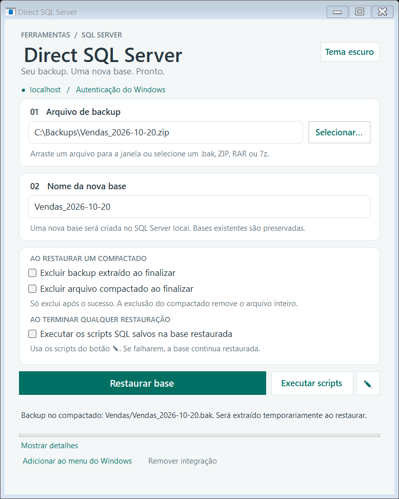

> **Versão atual: 1.10.1.** Veja o que mudou nas [notas de versão](CHANGELOG.md).

## Sumário

- [Destaques](#destaques)
- [Como funciona](#como-funciona)
- [Requisitos](#requisitos)
- [Instalação passo a passo](#instalação-passo-a-passo)
- [Restaurar um backup passo a passo](#restaurar-um-backup-passo-a-passo)
- [Via link: restaurar sem baixar](#via-link-restaurar-sem-baixar)
- [Via arquivo: backup dentro de um compactado](#via-arquivo-backup-dentro-de-um-compactado)
- [Configurações (opções da restauração)](#configurações-opções-da-restauração)
- [Opções ao terminar a restauração](#opções-ao-terminar-a-restauração)
- [Cancelar uma restauração](#cancelar-uma-restauração)
- [Executar scripts SQL na base restaurada](#executar-scripts-sql-na-base-restaurada)
- [Menu do botão direito no Explorer](#menu-do-botão-direito-no-explorer)
- [Tema claro e escuro](#tema-claro-e-escuro)
- [Atualizações automáticas](#atualizações-automáticas)
- [Segurança e o que o app nunca faz](#segurança-e-o-que-o-app-nunca-faz)
- [Onde ficam seus dados](#onde-ficam-seus-dados)
- [Solução de problemas](#solução-de-problemas)
- [Desinstalar](#desinstalar)
- [Limitações conhecidas](#limitações-conhecidas)

---

## Destaques

- **Um fluxo só:** origem (link ou arquivo), nome da base, **Restaurar base**. A conclusão aparece na própria janela.
- **Via link:** restaura direto de um link para um ZIP, sem baixar, sem extrair e sem gravar o `.bak` em disco. Mostra velocidade e tempo restante.
- **Aceita compactados:** ZIP, RAR, 7z, TAR, GZ, BZ2 e XZ. O motor 7-Zip já vem junto; você não precisa instalar 7-Zip nem WinRAR.
- **Arrastar e soltar** um arquivo para a janela.
- **Nunca substitui nada:** se já existir uma base com o nome escolhido, a restauração é recusada e nada é alterado.
- **Seguro por padrão:** conecta só no SQL Server **do próprio computador**, com a **autenticação do Windows**. Não pede nem guarda senha.
- **Cancelar** a restauração a qualquer momento, removendo a base parcial.
- **Depois de restaurar (opcional):** executar scripts SQL salvos e **reduzir o arquivo de log**.
- **Scripts SQL:** botão para rodar, e editar, comandos na base restaurada.
- **Menu do Explorer:** botão direito no arquivo → *Restaurar no SQL Server…* (opcional).
- **Tema claro e escuro.**
- **Atualização automática** com um clique.

## Como funciona

1. Você escolhe a origem: **Via link** (padrão) ou **Via arquivo**. Em ambos, se houver um compactado, o app procura os `.bak` dentro dele; se houver vários, você escolhe qual restaurar.
2. Você informa o nome da **nova** base. O app sugere um nome a partir do arquivo.
3. Ao clicar em **Restaurar base**, o app extrai o `.bak` (via arquivo compactado) ou lê o ZIP pela rede (via link), lê o conteúdo do backup e restaura todos os arquivos de dados e de log **com nomes novos e exclusivos** nas pastas padrão da instância. Ele **não** usa os caminhos do servidor de origem.
4. A restauração acontece primeiro com um nome interno (`DirectSqlRestore_<código>`). Só no final uma renomeação atômica publica a base com o nome que você escolheu.
5. Terminou: atualize a lista **Bancos de Dados** no SSMS com **F5**.

Se o arquivo `.bak` contiver vários backups completos da mesma base, o app usa o **mais recente**. Os detalhes (nome original, data e conjunto) aparecem em **Mostrar detalhes**.

## Requisitos

| Item | Requisito |
|---|---|
| Sistema | Windows 10 ou 11, 64 bits |
| .NET | **.NET 9 Desktop Runtime**. O instalador baixa e instala sozinho se você não tiver. |
| SQL Server | Instância **padrão local** (`MSSQLSERVER`), acessível como `localhost` |
| Permissões | Seu usuário do Windows precisa poder **restaurar bancos** e **listar os bancos existentes** |
| Espaço em disco | O tamanho do backup extraído (se vier de um compactado) mais o espaço da nova base |

> O backup precisa ser de uma versão do SQL Server **igual ou mais antiga** que a instalada no seu computador.

## Instalação passo a passo

1. Abra a página de [**Releases**](../../releases/latest) deste repositório.
2. Em **Assets**, baixe **`DirectSqlServer-win-Setup.exe`**.
3. Dê um duplo clique no arquivo. A instalação é **por usuário**: não pede senha de administrador e leva poucos segundos. Se faltar o .NET 9 Desktop Runtime, o instalador o instala junto.
4. Ao terminar, o app abre sozinho. Ele também cria atalhos na **área de trabalho** e no **menu Iniciar** com o nome **Direct SQL Server**.

### Aviso "O Windows protegeu o computador"

O instalador não tem assinatura digital paga, então o Windows SmartScreen pode mostrar essa tela na primeira execução. Clique em **Mais informações** e depois em **Executar assim mesmo**. Isso acontece só na instalação.

## Restaurar um backup passo a passo

### 1. Abra o app

Abra **Direct SQL Server** pelo atalho. A janela abre com **Via link** selecionado.

  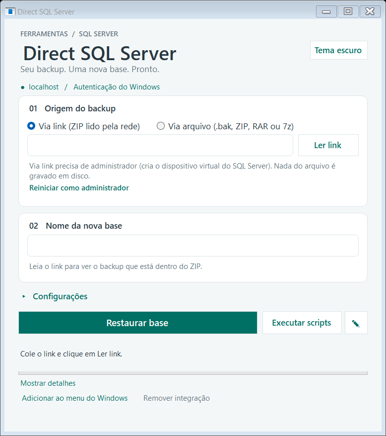

A faixa verde **localhost / Autenticação do Windows** lembra onde o app vai restaurar: o SQL Server deste computador, com o seu usuário do Windows.

### 2. Escolha a origem do backup

No cartão **01 Origem do backup** há duas opções. A linha abaixo muda conforme a escolha:

| Opção | Campo | O que faz |
|---|---|---|
| **Via link (ZIP lido pela rede)** | Cole o link e clique em **Ler link** | Lê o índice do ZIP pela rede e mostra o backup que está dentro dele. Veja [Via link](#via-link-restaurar-sem-baixar). |
| **Via arquivo (.bak, ZIP, RAR ou 7z)** | Clique em **Selecionar…** ou arraste o arquivo para a janela | Usa um arquivo do disco. Veja [Via arquivo](#via-arquivo-backup-dentro-de-um-compactado). |

  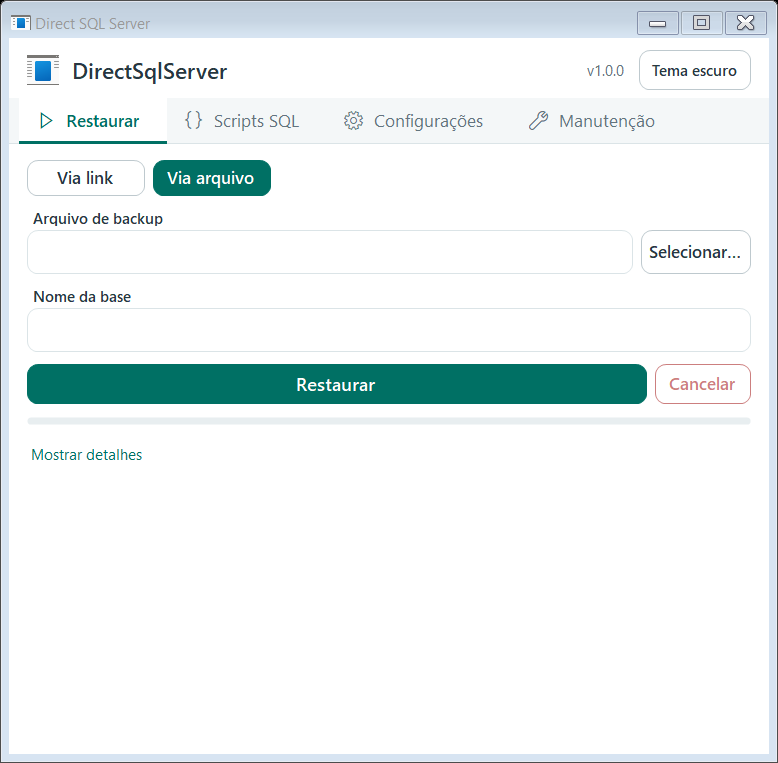

Arrastar um arquivo para a janela, ou usar o [menu do botão direito](#menu-do-botão-direito-no-explorer), seleciona **Via arquivo** automaticamente. Selecione **uma origem por vez**.

### 3. Confira o nome da nova base

O campo **02 Nome da nova base** é preenchido com o nome do arquivo (ou do `.bak` dentro do ZIP). Altere se quiser. O nome pode ter acentos e espaços; só não pode ser vazio, ter caracteres de controle, ter mais de 128 caracteres nem ser o nome de uma base do sistema (`master`, `model`, `msdb`, `tempdb`).

A mensagem abaixo do botão muda conforme a origem: via arquivo mostra **"Pronto para restaurar em uma nova base."**; via link mostra **"Pronto. O backup será lido direto da rede e entregue ao SQL Server."**

  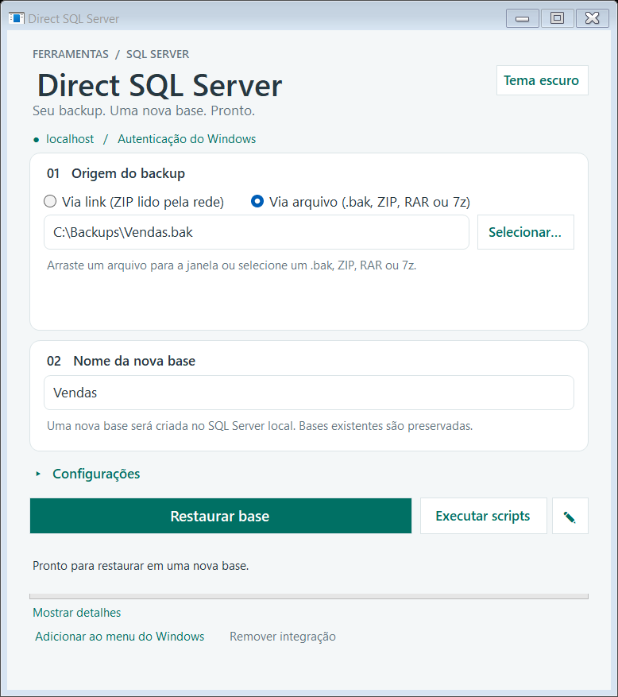

### 4. Clique em Restaurar base

O botão muda para **Restaurando…**, a barra de progresso avança e a janela **não fecha pelo X** até terminar, para não interromper a operação no meio.

  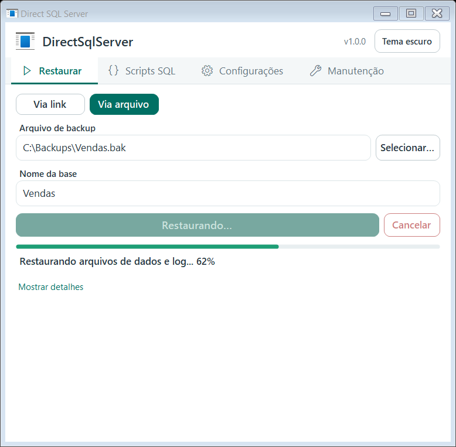

### 5. Veja o resultado

Se deu certo, aparece em verde **"Base “Vendas” restaurada com sucesso. Atualize a lista no SSMS (F5)."**

  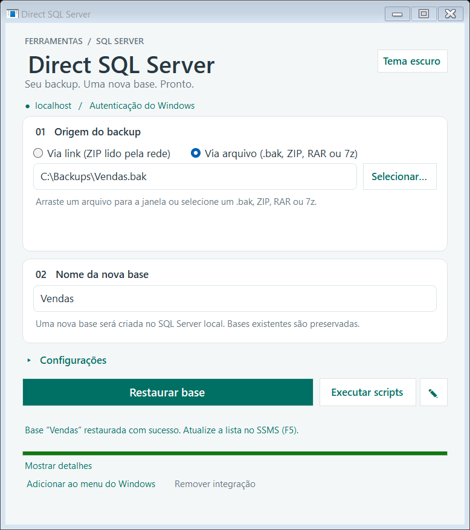

Se algo falhar, a mensagem aparece em vermelho e a seção de **detalhes** abre sozinha com o que aconteceu. Um registro completo é salvo em `%LOCALAPPDATA%\DirectSqlServer\Logs`.

  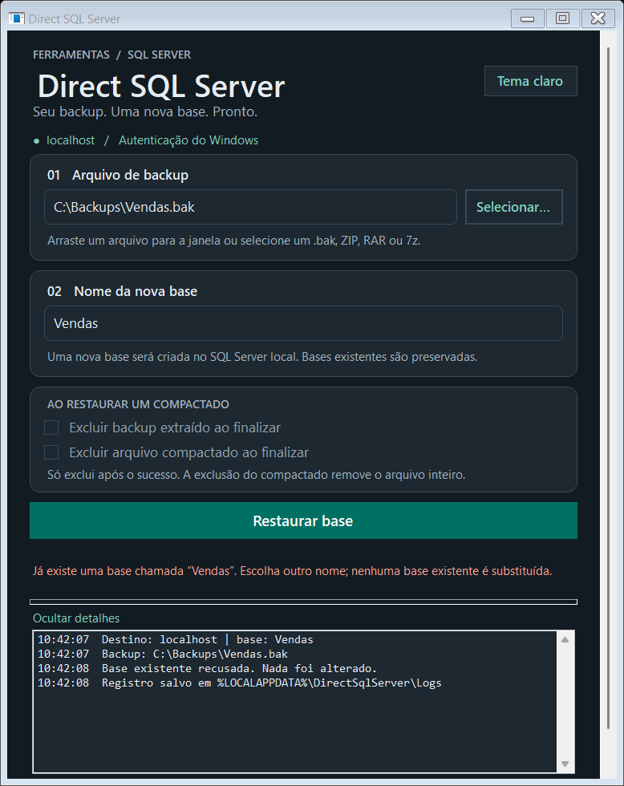

Use **Mostrar detalhes** / **Ocultar detalhes** quando quiser ver o passo a passo da restauração, mesmo sem erro.

## Via arquivo: backup dentro de um compactado

Selecione o ZIP, RAR ou 7z normalmente. O app procura o `.bak` lá dentro; **você não precisa extrair nada**.

- **Um `.bak` no compactado:** ele é usado direto, e o nome da base sugerida vem do nome do `.bak`.
- **Vários `.bak`:** abre uma janela para você escolher qual restaurar.

  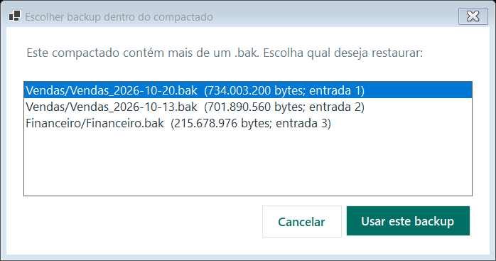

### Onde o backup é extraído

Só o `.bak` escolhido é gravado, como `<NomeDaBase>.bak`, numa **nova pasta `<NomeDaBase>` ao lado do arquivo compactado**. Se já existir uma pasta com esse nome, a nova pasta recebe um sufixo, como ` (2)`. Caminhos de dentro do compactado nunca são usados como destino.

Reserve espaço livre equivalente ao tamanho do `.bak`.

### Opções de exclusão

Com um compactado selecionado **via arquivo**, a caixa **AO RESTAURAR UM COMPACTADO (SÓ VIA ARQUIVO)** fica ativa. Via link ela fica desabilitada, porque não há `.bak` extraído nem compactado no disco:

| Opção | O que faz |
|---|---|
| **Excluir backup extraído ao finalizar** | Apaga o `.bak` extraído e a pasta criada, **depois** de restaurar com sucesso. |
| **Excluir arquivo compactado ao finalizar** | Apaga o compactado **inteiro** depois de restaurar com sucesso, **inclusive qualquer outro arquivo que ele contenha**. Não afeta `.bak` selecionado diretamente. |

  

- As duas começam **desmarcadas** no primeiro uso e a sua escolha fica salva (`%APPDATA%\DirectSqlServer\preferences.xml`).
- **Só excluem após o sucesso.** Se a restauração falhar, o original e o `.bak` extraído são **preservados**, mesmo com as opções marcadas.
- Antes de excluir o compactado, o app confere se ele é o mesmo arquivo que você selecionou; se outro programa o trocou ou alterou, **não é excluído**.

### Pasta que exige permissão

Se o Windows não deixar criar a pasta de extração ao lado do compactado (por exemplo, em `C:\inetpub\SQLServerData`), o app pede **autorização de administrador somente nesse caso** e continua com o mesmo arquivo, nome e opções. Se você cancelar o pedido, a janela original permanece e **nada é excluído**.

## Cancelar uma restauração

Enquanto a restauração roda (via link ou via arquivo), o botão **Cancelar** ocupa o lugar de **Executar scripts**, ao lado de **Restaurar base**.

1. Clique em **Cancelar** e confirme.
2. O app interrompe a leitura (extração ou download) e o RESTORE no SQL Server.
3. A base parcial (`DirectSqlRestore_…`) criada por aquela execução é **removida**. O nome que você escolheu nunca chega a aparecer, e nenhuma outra base é tocada.
4. Via arquivo, se o backup veio de um compactado, o `.bak` já extraído **é mantido** na pasta de extração, e o compactado original não é tocado.

Cancelar não é instantâneo em backups enormes: o SQL Server precisa desfazer o que já gravou e apagar os arquivos da base parcial, o que pode levar de alguns segundos a alguns minutos.

## Executar scripts SQL na base restaurada

Ao lado de **Restaurar base** há o botão **Executar scripts** e um lápis para editá-los. Eles rodam comandos SQL na base indicada em **Nome da nova base**, por exemplo para ajustar dados logo depois de restaurar um backup de produção.

1. **Veja ou altere os comandos:** clique no **lápis**. Abre uma janela com os scripts salvos (na primeira vez, o padrão do app). Edite como quiser e clique em **Salvar**. **Restaurar padrão** volta ao texto original.
2. **Execute:** confira o nome da base e clique em **Executar scripts**. O app pede confirmação mostrando o nome da base e quantos lotes serão executados.
3. **Resultado:** os detalhes abrem sozinhos mostrando cada lote e quantas linhas cada comando afetou.

  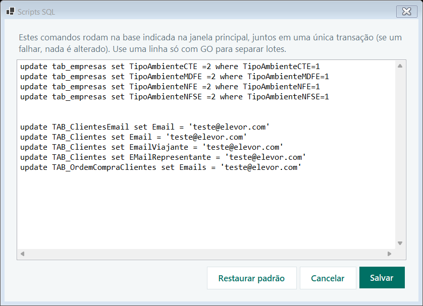

  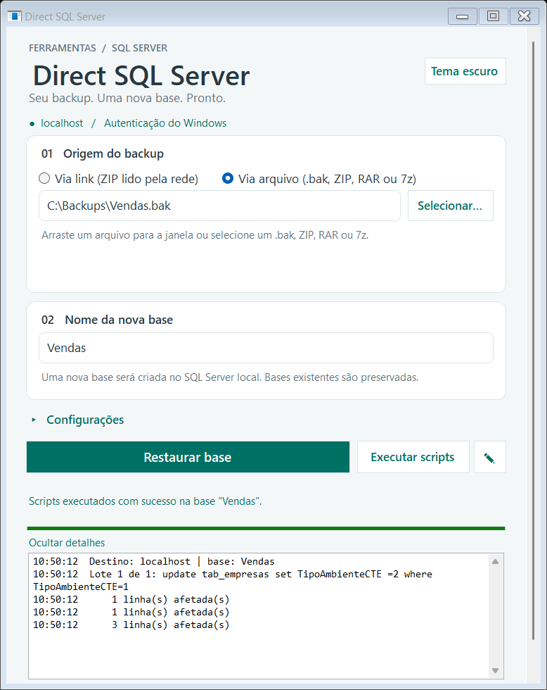

### Executar automaticamente depois de restaurar

Marcando **Executar os scripts SQL salvos na base restaurada**, o app roda os scripts salvos logo depois de **restaurar com sucesso**, sem pedir confirmação nem precisar clicar em **Executar scripts**.

- **Desmarcada por padrão.** A escolha fica salva em `%APPDATA%\DirectSqlServer\preferences.xml` e continua depois de reiniciar o PC.
- **Vale via arquivo e via link.**
- **Se os scripts falharem,** a base continua restaurada. Só os scripts são desfeitos (transação única) e o erro aparece em vermelho com os detalhes abertos.
- **Sem scripts salvos,** o app apenas avisa que não havia nada para executar.
- Como roda sem perguntar, confira o texto no editor (lápis) antes de marcar a opção.

### Regras da execução

- **Tudo ou nada:** todos os lotes rodam em **uma única transação**. Se um comando falhar, **nada é alterado**.
- **Lotes:** uma linha só com `GO` separa lotes, como no SSMS. Sem `GO`, tudo vai em um lote.
- **Só em base existente:** a base precisa existir e estar online. Bases de sistema (`master`, `model`, `msdb`, `tempdb`) são recusadas.
- **Fica salvo:** os scripts ficam em `%APPDATA%\DirectSqlServer\scripts.sql` e continuam lá depois de reiniciar o PC e de atualizar o app.
- **Cuidado:** os comandos alteram dados e **não dá para desfazer depois de concluídos**. Confira o nome da base antes de confirmar.

## Via link: restaurar sem baixar

Com **Via link** selecionado, o app restaura **direto de um link para um ZIP**, sem baixar o arquivo, sem extrair o `.bak` e sem gravá-lo em disco. Ele lê o ZIP pela rede e entrega o backup ao SQL Server por um dispositivo virtual (VDI). No disco só fica a base restaurada.

  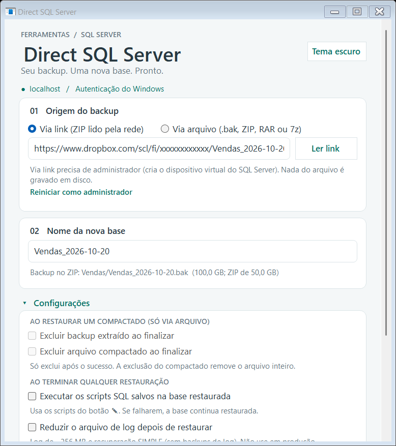

**Passo a passo**
1. Com **Via link** selecionado, o app mostra um aviso se não estiver como administrador (o dispositivo virtual exige isso). Clique em **Reiniciar como administrador**, aceite o pedido do Windows e o app reabre.
2. Cole o **link público (https)** de um `.zip` e clique em **Ler link**. Com o Dropbox, use o link com `dl=1` no final.
3. O app lê só o índice do ZIP e mostra o backup que está dentro dele, no cartão do nome. Se houver mais de um `.bak`, abre uma janela para você escolher. O nome da base é sugerido a partir do nome do `.bak`.
4. Confira o nome da nova base e clique em **Restaurar base**. A barra mostra quanto já foi lido da rede, a velocidade e o tempo restante.

  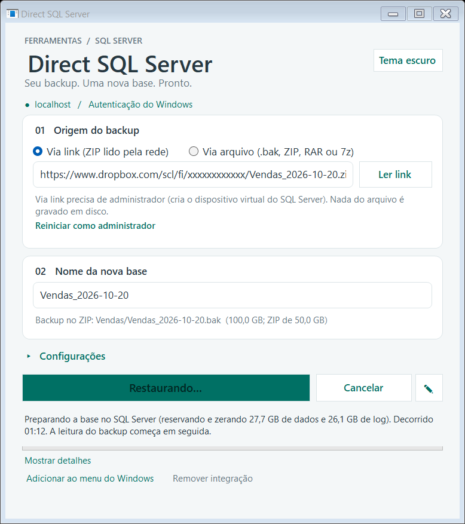

  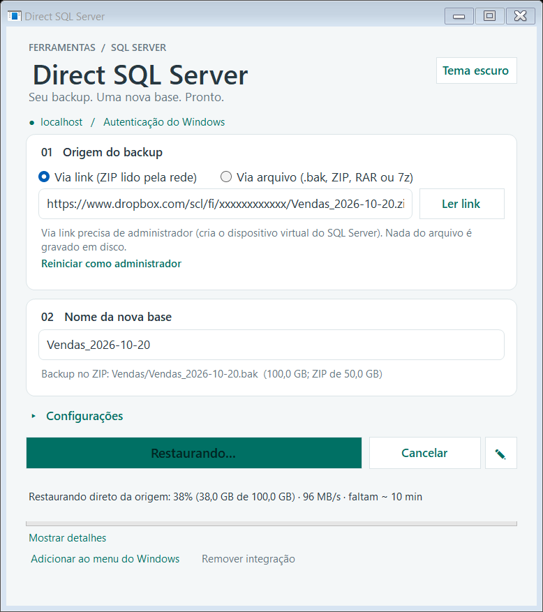

**Velocidade e tempo restante.** O app baixa vários blocos do ZIP ao mesmo tempo (8 conexões) e descompacta na frente do SQL Server. Em um teste com um link do Dropbox, a leitura passou de 14,6 MB/s (uma conexão) para 95,9 MB/s. A velocidade real depende da sua internet e do servidor do link. A barra de status mostra a **velocidade, a porcentagem e o tempo restante estimado**, calculado pela média do último minuto; nos primeiros segundos ainda não há estimativa.

**Por que o início fica em 0% por alguns minutos.** Antes de ler o backup, o próprio SQL Server cria e **zera** os arquivos da nova base, com o mesmo tamanho dos arquivos originais (inclusive o log, que em alguns bancos tem dezenas de GB). Isso não depende da rede nem do app. O app mostra "Preparando a base no SQL Server (reservando e zerando X GB de dados e Y GB de log)" com o tempo decorrido. Só depois a leitura começa e aparecem a porcentagem, a velocidade e o tempo restante. Em um backup com 27 GB de dados e 26 GB de log, a preparação levou cerca de 2 minutos e a leitura de 24 GB, cerca de 4 minutos.

**O que você economiza.** Hoje, com um ZIP de 50 GB e um backup de 100 GB, o pico de disco chega a cerca de 250 GB (ZIP + pasta extraída + base). Restaurando do link, o pico é só o da **base (100 GB)**.

**Limites do modo link**
- Só **ZIP**. RAR e 7z não podem ser lidos em partes pela rede.
- O servidor do link precisa aceitar **leitura parcial** (cabeçalho `Range`). O Dropbox aceita. Se o servidor não aceitar, o app avisa.
- Restaura o **primeiro backup** do `.bak`. Para arquivos com vários backups, use **Via arquivo**.
- Precisa de **administrador**. Em um app elevado, arrastar arquivos do Explorer para a janela não funciona (limitação do Windows); use **Selecionar…**.
- Se a conexão cair no meio, a restauração falha e o app informa; a base interna parcial só fica para você apagar se o SQL não conseguir removê-la. A base com o nome que você escolheu só aparece quando tudo termina.
- O link contém um código secreto: o app **não o grava** em log nem em arquivo.
- As opções de exclusão de arquivos não se aplicam (não há arquivo extraído nem compactado no disco). As opções de **depois da restauração** valem normalmente.
- Antes de começar, o app confere se há espaço livre para a base e recusa nomes de base já existentes.

## Configurações (opções da restauração)

Todas as opções ficam sob o título **Configurações**, entre o nome da base e o botão **Restaurar base**. Clique em **▸ Configurações** para expandir e em **▾ Configurações** para recolher. Recolhido (o padrão), o título mostra quantas opções estão ativas, por exemplo "▸ Configurações · 2 opções ativas".

  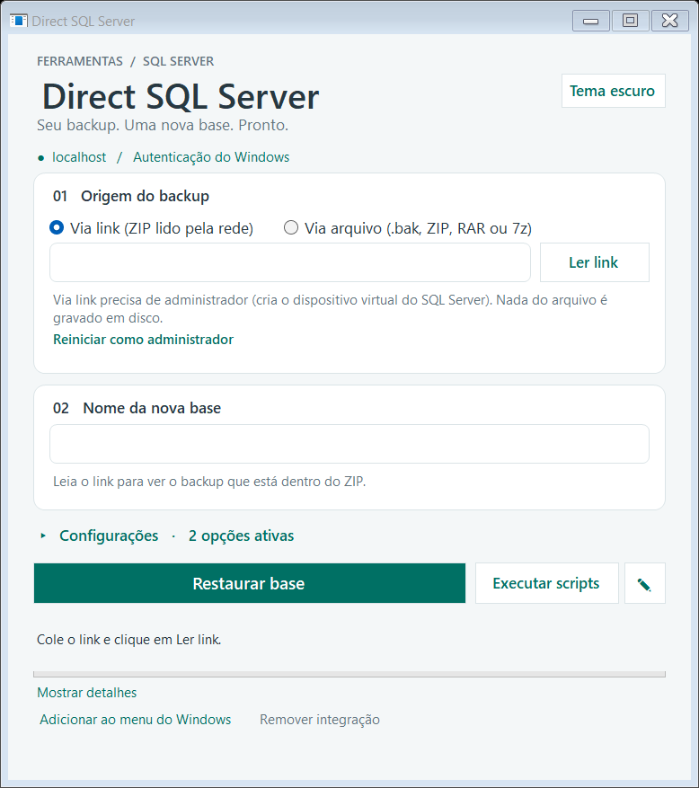

  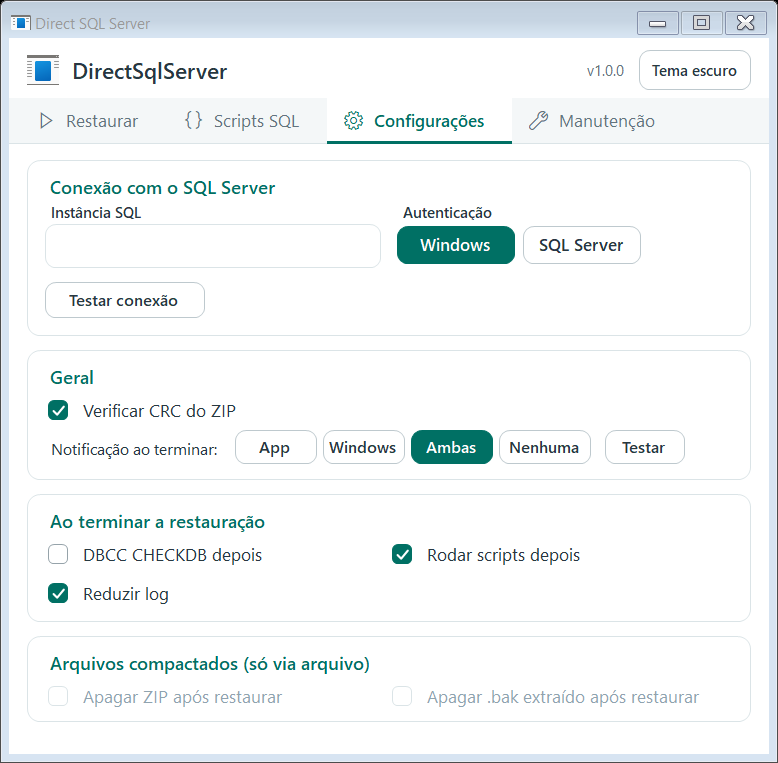

## Opções ao terminar a restauração

Em **AO TERMINAR QUALQUER RESTAURAÇÃO**, dentro de **Configurações**, valem para **via link e via arquivo**. Todas começam **desmarcadas**. A escolha de **Executar scripts** fica salva (`%APPDATA%\DirectSqlServer\preferences.xml`), inclusive depois de reiniciar o PC. A de **Reduzir o log não é lembrada**, de propósito, porque muda o modelo de recuperação da base: você marca de novo quando quiser.

| Opção | O que faz |
|---|---|
| **Executar os scripts SQL salvos na base restaurada** | Roda os scripts do botão ✎ logo depois de restaurar com sucesso, sem pedir confirmação. Veja [Executar scripts SQL](#executar-scripts-sql-na-base-restaurada). |
| **Reduzir o arquivo de log depois de restaurar** | Reduz o log da base restaurada para cerca de 256 MB (veja abaixo). **Não é lembrada**: começa sempre desmarcada, toda vez que o app abre. |

Se uma etapa falhar, a base continua restaurada e a mensagem em vermelho explica o que não deu certo. Quando tudo dá certo, a mensagem final lista o que foi feito: "Base “X” restaurada, scripts executados, log reduzido."

### Reduzir o arquivo de log

Uma restauração recria o arquivo de log com o **tamanho do original**, que pode ter dezenas de GB e estar quase vazio. Marcando esta opção, o app:

1. muda o modelo de recuperação da base para **SIMPLE**;
2. executa `CHECKPOINT` e `DBCC SHRINKFILE` no(s) arquivo(s) de log, com alvo de **256 MB** (até 3 passadas);
3. mostra no detalhe o tamanho antes e depois, por exemplo "Log “Base_log”: 26,1 GB → 280 MB".

Cuidados:
- **`SIMPLE` quebra a cadeia de backups de log.** Use em cópias de teste ou homologação, **não** em base de produção com backups de log.
- O SQL só devolve espaço em múltiplos dos segmentos internos do log, então o resultado fica **perto** de 256 MB, não exatamente nele.
- Se a base tiver atividade, o log volta a crescer conforme o uso.
- Reduzir o log **não acelera** a restauração: o SQL ainda cria e zera o log inteiro antes de ler o backup. Só libera disco depois.

## Menu do botão direito no Explorer

Opcional. No rodapé da janela, clique em **Adicionar ao menu do Windows**. Depois, no Explorer:

1. Clique com o botão direito em um `.bak`, `.zip`, `.rar` ou `.7z`.
2. No Windows 11, escolha **Mostrar mais opções**.
3. Clique em **Restaurar no SQL Server…**. O app abre com o arquivo já selecionado.

Para tirar o menu, clique em **Remover integração**. Isso **não** exclui bases, backups nem o app. Desinstalar o app também remove o menu.

## Tema claro e escuro

O botão no canto superior direito alterna entre **Tema escuro** e **Tema claro**. A escolha é salva e vale nas próximas aberturas.

  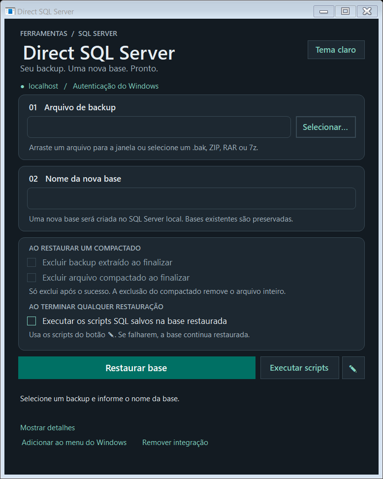

## Atualizações automáticas

Ao abrir, o app verifica em segundo plano se há versão nova. Quando houver, o link do rodapé muda para **Nova versão X disponível: atualizar agora**.

  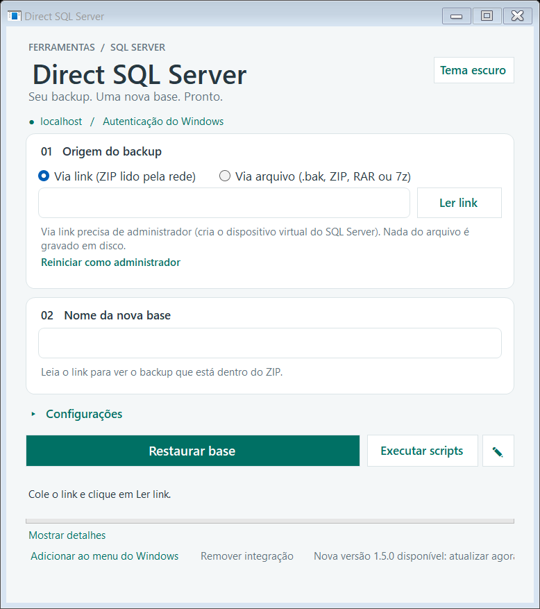

1. Clique no link. O app baixa a atualização (mostrando o progresso).
2. Ao terminar, ele **reinicia sozinho** já na versão nova.

O link **Verificar atualizações** também permite checar manualmente. Ele só aparece no app instalado pelo instalador. Se houver uma restauração em andamento, a atualização espera você terminar.

Suas preferências, tema e registros ficam fora da pasta do app e **não são apagados** na atualização.

## Segurança e o que o app nunca faz

- **Só o seu computador.** A conexão usa memória compartilhada (`lpc:localhost`), o que a restringe a esta máquina mesmo que existam atalhos de rede configurados.
- **Autenticação do Windows.** Não existe campo de senha, e nada de credencial é gravado.
- **Nunca usa `WITH REPLACE`**, não derruba conexões e não exclui bases suas. Base existente ou de sistema é recusada.
- **Uma restauração por vez:** um bloqueio no SQL impede duas restaurações simultâneas do app.
- **Backup original protegido:** fica bloqueado contra escrita e exclusão durante a operação.
- **Sem telemetria.** Nenhum registro é enviado para fora; eles ficam só no seu computador. A única comunicação externa é a verificação de atualização no GitHub.

### Quando o SQL Server não consegue ler o arquivo

Se o serviço do SQL Server não tem permissão para ler o backup (comum em Downloads ou na área de trabalho), o app faz uma **cópia temporária privada** em `%ProgramData%\DirectSqlServer-<seu-SID>\<código>\backup.bak`, acessível só ao seu usuário, ao sistema e (leitura) ao serviço do SQL. A permissão do arquivo original não é alterada, e a cópia é apagada ao terminar, com sucesso ou falha. Isso exige espaço livre equivalente ao backup.

## Onde ficam seus dados

| O quê | Onde |
|---|---|
| Aplicativo instalado | `%LOCALAPPDATA%\DirectSqlServer` |
| Opções das caixas de marcar (exclusão e scripts automáticos) | `%APPDATA%\DirectSqlServer\preferences.xml` |
| Tema | `%APPDATA%\DirectSqlServer\theme.txt` |
| Scripts SQL | `%APPDATA%\DirectSqlServer\scripts.sql` |
| Registros de cada restauração | `%LOCALAPPDATA%\DirectSqlServer\Logs` (contêm nomes de bases e caminhos locais) |
| Cópia temporária (só quando necessária) | `%ProgramData%\DirectSqlServer-<SID>\` |
| Falha de integração com o Explorer | `%TEMP%\DirectSqlServer-install-error.txt` |

## Solução de problemas

| Sintoma | O que fazer |
|---|---|
| **"Já existe uma base chamada…"** | Escolha outro nome. O app nunca substitui uma base existente. Se quiser trocar, renomeie ou exclua a antiga no SSMS antes. |
| **Não conecta ao SQL Server** | O app usa a instância padrão local (`MSSQLSERVER`). Confirme que o serviço está iniciado e que o seu usuário do Windows tem permissão para restaurar bancos. |
| **Backup de versão mais nova** | O SQL Server não restaura backup de versão superior à instalada. Atualize o SQL Server local ou restaure em outro servidor. |
| **Backup criptografado** | Exige certificado ou chave já disponível no servidor. |
| **Compactado com senha ou formato desconhecido** | O app mostra uma mensagem de erro e preserva o arquivo. Extraia manualmente e selecione o `.bak`. |
| **A restauração falhou no meio** | Pode restar uma base interna `DirectSqlRestore_…` incompleta. O app informa o nome nos detalhes e a mantém para inspeção no SSMS; apague-a por lá. |
| **Segunda base com o mesmo nome criada por outra ferramenta durante a restauração** | A base externa fica intacta e a sua restauração permanece com o nome interno, informado nos detalhes. |
| **"O Windows protegeu o computador"** | Veja [o aviso na instalação](#aviso-o-windows-protegeu-o-computador). |
| **O menu do botão direito não aparece** | No Windows 11, use **Mostrar mais opções**. Se ainda assim faltar, clique em **Adicionar ao menu do Windows** de novo. |
| **O app não atualiza** | Confira a internet e clique em **Verificar atualizações**. A mensagem de erro aparece na barra de status. |

Em caso de dúvida, abra o arquivo mais recente em `%LOCALAPPDATA%\DirectSqlServer\Logs`: ele traz o passo a passo e o erro completo.

## Desinstalar

1. Abra **Configurações → Aplicativos → Aplicativos instalados**.
2. Procure **Direct SQL Server** e clique em **Desinstalar**.

Isso remove o app, os atalhos e o menu do Explorer. **Suas bases, seus backups e as pastas extraídas não são tocados.** As preferências e os registros em `%APPDATA%` e `%LOCALAPPDATA%\DirectSqlServer\Logs` ficam; apague-os à mão se quiser.

## Limitações conhecidas

- Restaura **backup completo** de um arquivo `.bak`, com dados e logs convencionais (MDF/NDF/LDF). **Diferenciais e backups de log não são aplicados.**
- Para backup **dividido em vários arquivos**, `.bak` com backups de **bases diferentes**, FILESTREAM e arquivos especiais, snapshots e cadeias de recuperação, use o SSMS.
- Só **instância padrão local** (`MSSQLSERVER`).
- Compactados dentro de outros compactados não são percorridos (exceto TAR comprimido, como `.tar.gz`).
- Arquivos GZ, BZ2 e XZ sem tamanho conhecido precisam ser lidos por inteiro antes da extração.
- O app não é assinado digitalmente (veja o aviso do Windows na instalação).
- O motor de extração é o **7-Zip** (copyright Igor Pavlov), distribuído com as licenças originais em `tools\7zip`. Código e condições em [7-zip.org](https://www.7-zip.org/).
